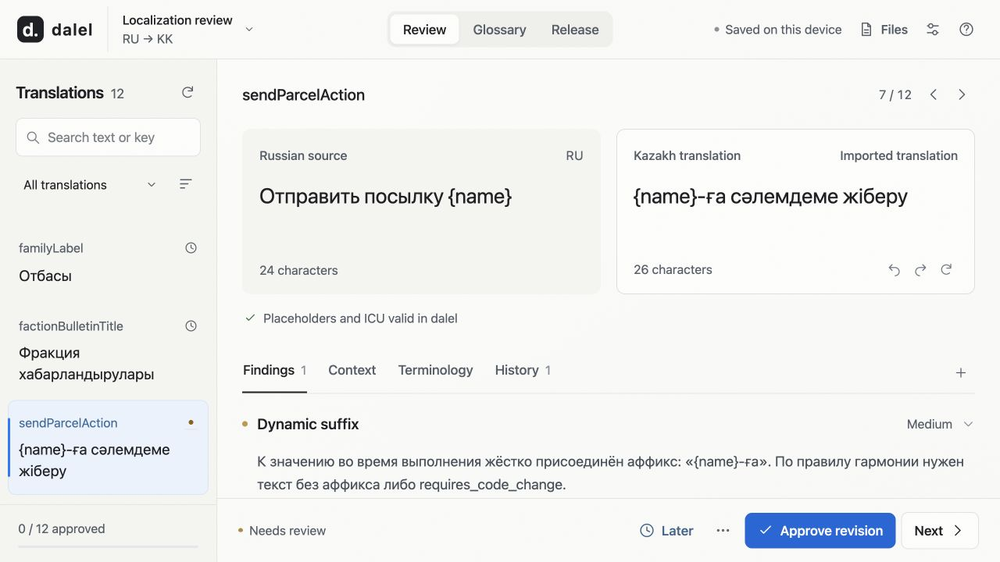
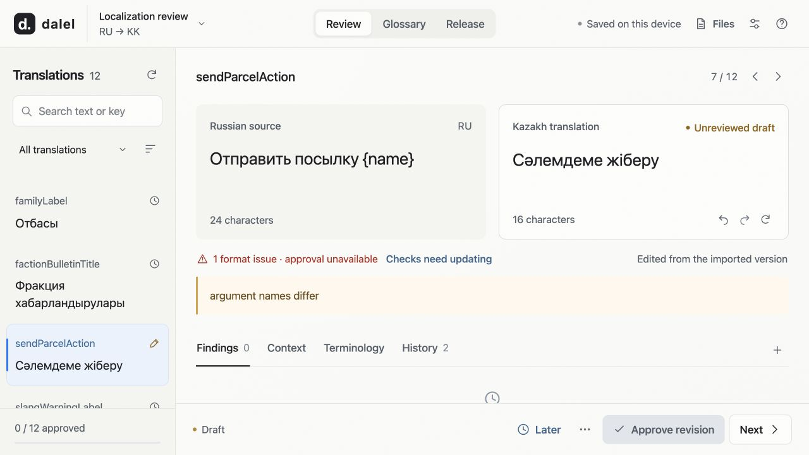
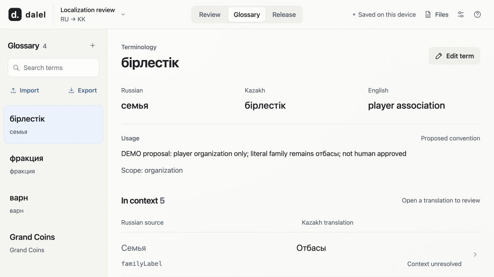
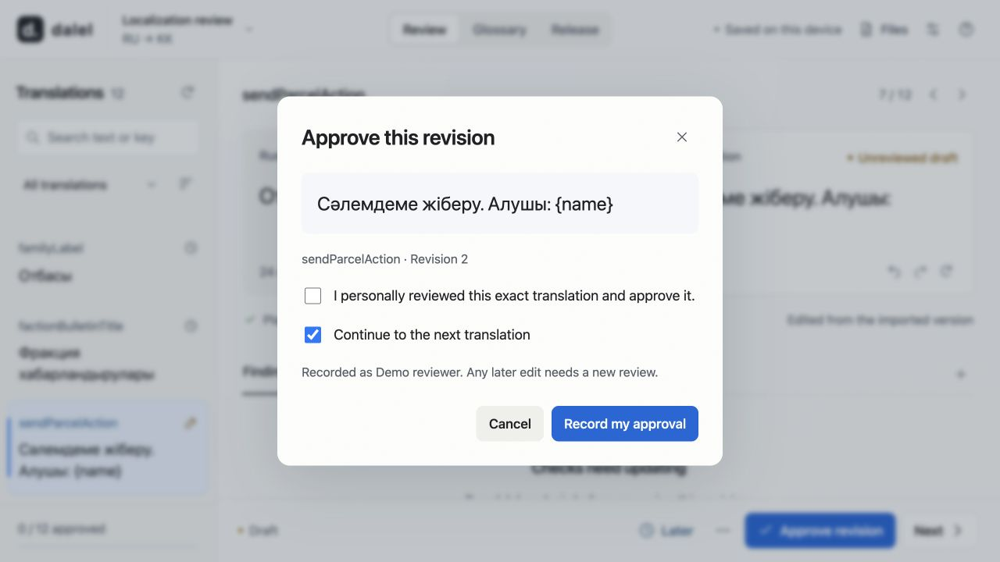
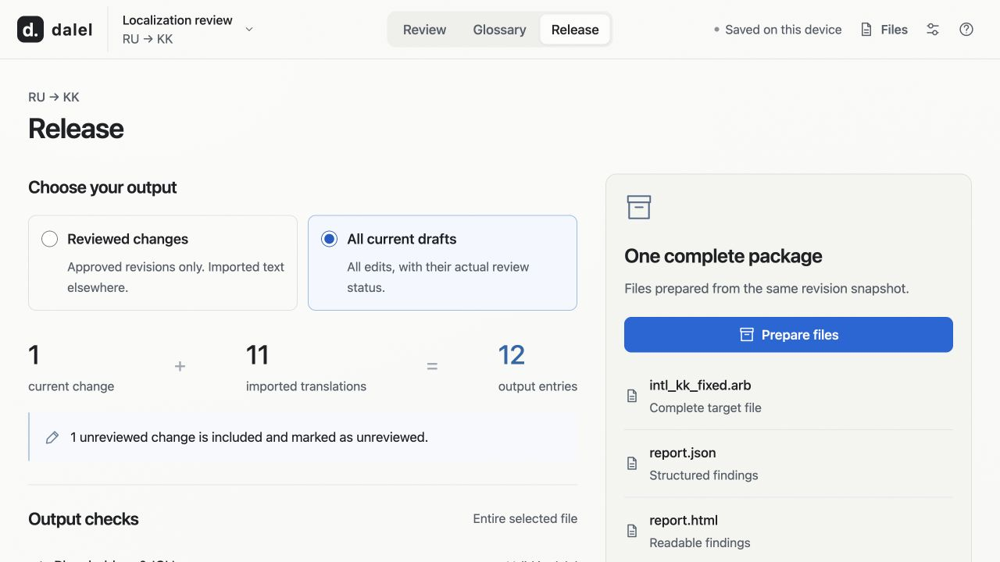
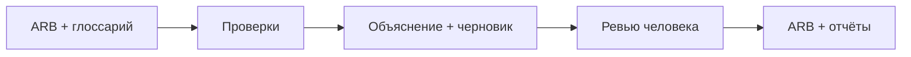

# dalel

**Найти ошибку в переводе. Объяснить её. Выпустить проверенное исправление.**

Я спроектировал и собрал инструмент контроля казахской и узбекской локализации для кейса **Grand Mobile на двухдневном хакатоне «decentrathon 6.0»**. От проверки файлов до редактора и экспорта — один рабочий процесс.

**Мой вклад:** архитектура, Python-движок, языковые промпты, браузерный интерфейс и тесты.

| Проблема | Моё решение |
| --- | --- |
| Ошибки перевода приходится искать вручную | 11 типов находок с причиной, важностью и предложением исправления |
| Модель может предложить неверную правку | Исходник и контекст рядом; человек утверждает точную версию текста |
| Исправленный перевод может сломать приложение | Проверки плейсхолдеров и ICU, сохранение ARB, интеграция с Flutter |



*Рабочий интерфейс на независимо созданных примерах. Конкурсные данные остаются приватными.*

## От проверки к выпуску

**Проверка структуры.** При потере `{name}` редактор показывает причину и блокирует утверждение.

[](docs/images/readme/validation.jpg)

**Глоссарий в контексте.** В карточке термина видны варианты перевода, правило употребления и связанные строки.

[](docs/images/readme/glossary.jpg)

**Ревью точной версии.** Перед утверждением редактор видит текст и номер версии.

[](docs/images/readme/review.jpg)

**Экспорт пакета.** Исправленный ARB, JSON и HTML формируются из одного снимка правок.

[](docs/images/readme/release.jpg)

## Почему устроено именно так

**Правила проверяют структуру, модель помогает со смыслом.** Локальные проверки находят пропуски, повреждённые параметры и другие формальные проблемы. Языковой анализ использует готовую модель, глоссарий и контекст игры. Обучения модели в проекте нет.

**Одобрение принадлежит версии строки.** Предложение модели, черновик и решение человека хранятся отдельно. Любая следующая правка снимает прежнее одобрение.

**Один движок обслуживает CLI и интерфейс.** Проверку можно запустить в терминале, разобрать находки в локальном редакторе и получить ARB, JSON и HTML-отчёт из одного состояния.



## Запустить

Python 3.10+, из каталога репозитория:

```sh
python -m venv .venv
source .venv/bin/activate
python -m pip install .
dalel serve
```

В Windows PowerShell активация: `.venv\Scripts\Activate.ps1`.
В редакторе: **Open files → свои ARB → Check all translations**. Файлы сохраняются локально; модельные запросы по умолчанию отключены.

CLI сохраняет команду из технического задания:

```sh
locqa check --source intl_ru.arb --target intl_kk.arb \
  --glossary glossary.csv --out report.json
```

Рядом создаётся `report.html`. [Все команды и настройка →](docs/guide.md)

## Результат и границы

Рабочий инструмент с **291 программным тестом**, локальным редактором, автономными отчётами и GitHub Action. Дополнительно — узбекский язык и транслитерация казахского в латиницу по явно указанному профилю.

Тесты подтверждают поведение программы. Качество переводов требует оценки носителями; результатов скрытого теста здесь нет. Конкретный исправленный файл проверяется отдельным запуском `flutter gen-l10n`.

**Python · Typer · Pydantic · SQLite · JavaScript · Flutter ARB**

[Руководство](docs/guide.md) · [Решения](NOTES.md) · [Методика](METHODOLOGY.md) · [Архитектура](docs/design.md) · [Контракт](docs/contract.md)

[GPL-3.0-only](LICENSE). Лицензии и обязательное авторство ресурсов Apertium сохранены.
